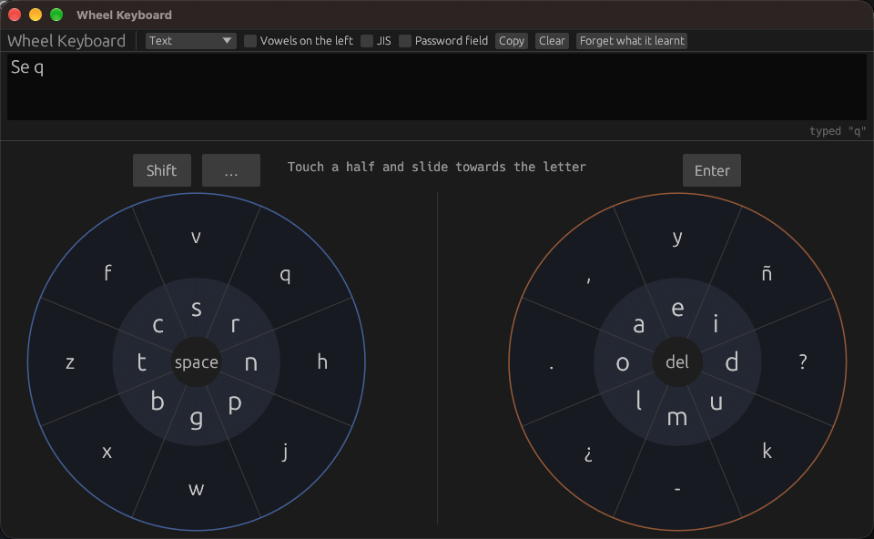
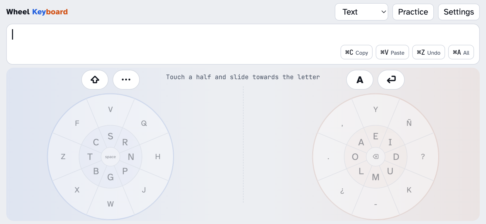

# Wheel Keyboard

[](https://github.com/SekaiBuilder/wheel-keyboard/actions/workflows/ci.yml)
[](LICENSE)

A two-thumb keyboard for touchscreens. Each thumb gets a wheel with eight
directions and two rings: touch, slide towards the letter, lift. An on-device
model learns how you write, highlights the likely next letter, fixes taps that
land right on the border between two letters, and suggests words. Nothing
leaves the device.

**[Try it in your browser →](https://sekaibuilder.github.io/wheel-keyboard/)**
(phone in landscape works best)



<details><summary>Browser demo</summary>



</details>

## What's in the repo

| Path | What it is |
|---|---|
| [`crates/wheel-keyboard`](crates/wheel-keyboard) | **The engine, in Rust.** No dependencies, no platform code: feed it touches, get back what to type. Layout, gestures with hysteresis, learning model, border correction, suggestions. |
| [`crates/wheel-keyboard-ffi`](crates/wheel-keyboard-ffi) | **C API** (`libwheel_keyboard_c`, header in `include/wheel_keyboard.h`) to embed the engine in Swift, Kotlin/JNI, C, C++ or anything that can call C. |
| [`crates/wheel-keyboard-desktop`](crates/wheel-keyboard-desktop) | **Desktop app** for macOS, Windows and Linux. Works with a touchscreen (both thumbs at once) or with a mouse or trackpad. |
| [`docs/index.html`](docs/index.html) | Browser demo (one HTML file, no build), the page behind the link above. It is a test bench: the Rust engine is the reference. |
| [`docs/SPEC.md`](docs/SPEC.md) | Requirements, acceptance criteria and design decisions. |

## Use it

### On your computer

```bash
cargo run --release -p wheel-keyboard-desktop
```

The left half of the window is the left wheel and the right half the right
one. With a touchscreen you can use both thumbs at once. What it learns is
saved in a text file in your user data folder (`~/Library/Application
Support/wheel-keyboard/` on macOS, `%APPDATA%\wheel-keyboard\` on Windows,
`~/.local/share/wheel-keyboard/` on Linux).

### In a Rust app

```toml
[dependencies]
wheel-keyboard = { git = "https://github.com/SekaiBuilder/wheel-keyboard" }
```

```rust
use wheel_keyboard::{Action, Keyboard, Side};

let mut kb = Keyboard::default();
// Left thumb (consonants): touch, slide up 40 px on a 100 px wheel, lift.
kb.touch_down(Side::Left, 200.0, 300.0, 100.0, 0);
kb.touch_move(Side::Left, 200.0, 260.0, 16);
for action in kb.touch_up(Side::Left, 32) {
    match action {
        Action::Text(s) => { /* insert s */ }
        Action::Backspace(n) => { /* delete n characters */ }
        Action::Key { key, mods } => { /* Enter, arrows, ⌘C… */ }
        Action::Kana(on) => { /* JIS かな / 英数 */ }
    }
}
```

Call `kb.tick(now_ms)` every frame while a thumb is down (Backspace repeat and
chords). To draw, use `kb.rings(side)`, `kb.selection(side)`, `kb.highlights()`,
`kb.preview(side, now)` and `kb.suggestions()`. Save what it learnt with
`kb.model().to_text()` and load it with `Model::from_text`.

### In an iOS, Android or C/C++ app

```bash
cargo build --release -p wheel-keyboard-ffi
```

This builds `target/release/libwheel_keyboard_c.a` (static) and the dynamic
library. Include `crates/wheel-keyboard-ffi/include/wheel_keyboard.h`; a
minimal host is in [`examples/c/main.c`](examples/c/main.c). For iOS, build
for `aarch64-apple-ios` and link the static library; for Android, build with
`cargo ndk` and call it through JNI.

## How it works

- **Two wheels, one per thumb.** The wheel opens where the thumb lands. A tap
  without moving types Space (consonant wheel) or deletes (vowel wheel; hold
  to keep deleting).
- **Eight directions, two rings.** The inner ring holds the 16 most frequent
  letters of the built-in layout (about 95 % of written Spanish); the outer
  ring holds the rarer ones and punctuation. Eight is the most directions
  people hit reliably without looking.
- **Vowels on one thumb, consonants on the other.** Most syllables alternate
  consonant and vowel, so the thumbs take turns on their own. Either hand can
  take the vowels.
- **Space rides with the consonants** to balance the load (about 47 % / 48 %
  of strokes per thumb, estimated).
- **Short step between rings, with a cue.** Crossing to the outer ring gives a
  haptic tick (or a flash where the platform can't vibrate mid-gesture). You
  don't have to reach the letter.
- **⋯ layer** with ⌘ ⌥ ⌃ ⇧ Esc ⇥, arrows, numbers and context-dependent
  symbols (text or terminal). A modifier applies to the next key, a double tap
  locks it, and resting the left thumb on ⌘ turns the right wheel into
  shortcuts (C Copy, V Paste…).
- **JIS keyboards** get the あ/A button (かな/英数) and ¥.
- **Accents:** hold a vowel still.

### Prediction that learns

- Starts empty. When a word ends it counts which letter followed the previous
  0–3 letters, which words you use and which word tends to follow which.
- Highlights up to three likely letters **without resizing or moving them**, so
  muscle memory keeps working.
- **Border rule:** if the thumb is in the middle of a letter, you get that
  letter, always. Only within 8° of a border may prediction pick the
  neighbour, and only if it is much likelier. The preview shows it before you
  lift ("corrected"). If it gets it wrong, Backspace right away restores the
  letter you touched and makes it more cautious.
- A bar of three suggested words.
- Nothing leaves the device, and in password fields it neither learns nor
  suggests.

## Layouts

The built-in layout (`Layout::spanish()`) is the one the project was designed
and tested with. `Layout` is a plain struct: build your own for another
language by putting that language's 16 most frequent letters in the inner
rings and splitting vowels and consonants between the thumbs.

## How it was decided

| Version | What it was | Verdict |
|---|---|---|
| v1 | Rings ordered by letter frequency | Dropped: felt scattered; something closer to a familiar keyboard was wanted |
| v2 | Three-row QWERTY fan (numbers on top) with row hysteresis | Dropped: three rows were hard to use |
| v3 | Eight directions, vowels and consonants on different thumbs, prediction | Chosen among three proposals (eight directions, swipe keys, two-hand daisy wheel) |
| v3.1 | Full circle always visible, buttons above each thumb, shorter and softer step between rings | Current |

## Sources

Keyboard design and gesture input:
- Kurtenbach & Buxton, *marking menus* (1993–94): choosing by direction is
  faster than menus; up to 8 options per level with few errors.
- Japanese *flick* keyboard (kana): touch and slide in a cross.
- [MessagEase](https://www.exideas.com/ME/) and
  [Thumb-Key](https://github.com/dessalines/thumb-key): frequent letters on the
  shortest gesture, fixed layout.
- [KALQ](https://keithv.com/pub/twothumb/): Oulasvirta et al., "Improving
  Two-Thumb Text Entry on Touchscreen Devices", CHI 2013. Split keyboard,
  vowels on one thumb, 37 wpm with practice.
- [8VIM](https://github.com/8VIM/8VIM): circle with chained gestures (what to
  avoid: hard to learn).
- [Unexpected Keyboard](https://github.com/Julow/Unexpected-Keyboard):
  modifiers and terminal symbols one swipe away.
- The Steam controller "daisy wheel" keyboard.

Prediction and correction:
- [The Machine Intelligence Behind Gboard](https://research.google/blog/the-machine-intelligence-behind-gboard/)
  and [Spatial model personalization in Gboard](https://research.google/pubs/spatial-model-personalization-in-gboard/)
  (Sivek & Riley, 2022).
- [Usability Guided Key-Target Resizing for Soft Keyboards](https://www.microsoft.com/en-us/research/publication/usability-guided-key-target-resizing-for-soft-keyboards/),
  Gunawardana, Paek & Meek, IUI 2010
  ([DOI 10.1145/1719970.1719986](https://doi.org/10.1145/1719970.1719986)):
  grow likely keys without taking any key's centre away.
- Goodman et al., "Language modeling for soft keyboards", 2002.
- [FlorisBoard](https://github.com/florisboard/florisboard): an open keyboard
  with suggestions.

## Origin

It started as part of remote-mac, an app to control a Mac from an iPhone or
iPad, where it is a selectable keyboard type. Letters are sent as text, so they
work with any Mac layout (Spanish, JIS, US).

## License and credit

[Apache License 2.0](LICENSE). You can use it, change it and ship it in free or
commercial products. **If you use it, you must credit the author**: keep the
[`NOTICE`](NOTICE) file and show

> Wheel Keyboard by Francesco Catania (@sekaibuilder)

where your product lists its credits or third-party notices. Contributing?
See [CONTRIBUTING.md](CONTRIBUTING.md). Privacy and security:
[SECURITY.md](SECURITY.md).
